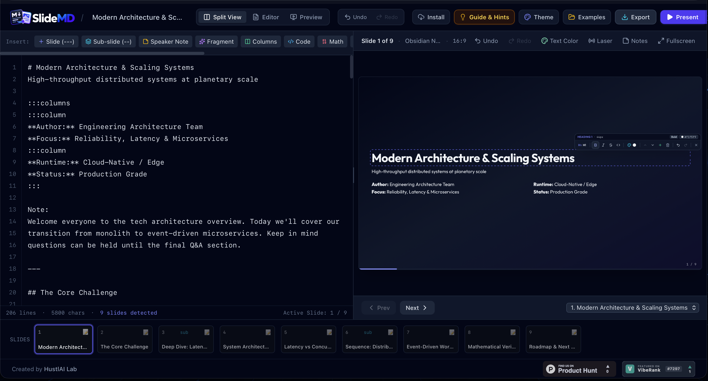
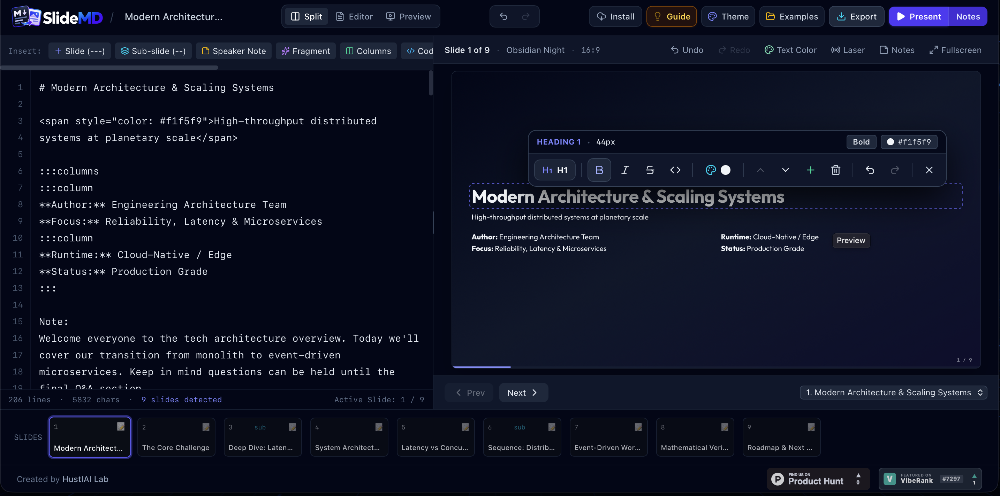

<div align="center">
  

  # SlideMD Presentation Studio

  **Transform Markdown into interactive, conference-ready slide decks in seconds.**  
  *100% client-side · Offline-first PWA · WYSIWYG Visual Overlay · Custom Theme Studio · Zero server costs*

  [](https://www.typescriptlang.org/)
  [](https://react.dev/)
  [](https://vitejs.dev/)
  [](https://tailwindcss.com/)
  [](#progressive-web-app-pwa--offline-mode)
</div>

---

## Overview

**SlideMD** is a self-hostable, privacy-first Markdown presentation studio that runs entirely in the browser. Write clean Markdown on the left—or click any element directly on the live slide canvas to format and rearrange blocks visually—and present immediately with a dual-screen presenter console, laser pointer, Mermaid diagrams, KaTeX math typesetting, and one-click exports to standalone offline HTML, Microsoft PowerPoint (`.pptx`), and vector PDF.

### Studio Interface & WYSIWYG Visual Overlay



*Live split-screen authoring with real-time Markdown synchronization, multi-column layouts, and the interactive click-to-edit visual formatting toolbar.*



*Direct on-slide element formatting with instant heading scale, weight, inline color picker, block reordering, and full undo/redo history.*

---

## Key Features

- **Live Split-Pane Markdown Studio**: Resizable split view (`Editor`, `Split View`, `Preview`) with synchronized scrolling, syntax toolbar snippets, and automatic local storage persistence.
- **WYSIWYG Click-to-Edit & Drag-and-Drop Overlay**: Click any heading, paragraph, list, or column on the slide preview to change typography, colors, alignment, or reorder blocks directly—automatically writing clean Markdown back to your source document.
- **Visual Theme Customizer & Palette Creator**:
  - **8 Built-in Curated Themes**: *Obsidian Night*, *Architectural Minimal*, *Nordic Frost*, *Dracula Cyber*, *Solarized Paper*, *Navy Executive*, *Emerald Forest*, and *Sunset Horizon*.
  - **Custom Palette Studio**: Pick custom hex colors for background, surface, headings, body text, accents, and code blocks—or apply 1-click color harmony presets with live WCAG 2.1 contrast ratio verification (`AAA` / `AA`).
  - **Curated Font Pairings**: Switch between *Modern Sans (Outfit + Plus Jakarta Sans)*, *Editorial Serif (Playfair Display)*, *Cyber Technical (Space Grotesk)*, *Warm Humanist (Inter)*, *Dynamic Impact (Syne)*, and *Terminal Mono (JetBrains Mono)*.
- **Pre-Designed Template Gallery**: Start new decks immediately from 10+ multi-slide templates across **Corporate**, **Minimalist**, **Creative**, **Academic**, and **Technical** categories with an interactive slide-by-slide preview inspector.
- **Rich Technical Content**:
  - **Mermaid.js Diagrams**: Flowcharts (`graph LR`), sequence diagrams (`sequenceDiagram`), and quantitative bar/line charts (`xychart-beta`).
  - **KaTeX Math Equations**: Native inline (`$E = mc^2$`) and display (`$$...$$`) LaTeX math rendering.
  - **Syntax-Highlighted Code Blocks**: Powered by `highlight.js` with multiple code themes (`atom-one-dark`, `github-dark`, `github-light`, `monokai`).
  - **Multi-Column & Layout Snippets**: Responsive `:::columns` directives plus 1-click visual layouts (KPI Grids, Hero Quotes, Before/After Comparisons, Timelines, Team Grids).
- **Conference-Grade Presenter Mode**:
  - **Dual-Window Sync (`BroadcastChannel` API)**: Launch a clean Audience Stage window on a secondary monitor/projector while keeping private Speaker Notes, next-slide preview, and presentation timer on your laptop.
  - **Interactive Stage Tools**: Red laser pointer, blackout screen (`B`), bird's-eye slide matrix (`O`), and step-by-step animated fragments (`:::fragment`).
- **Universal Export Engine**:
  - **Standalone Single-File HTML**: Self-contained `.html` file that runs offline in any browser with zero external dependencies.
  - **Editable PowerPoint (`.pptx`)**: Client-side synthesis via `pptxgenjs` preserving slide titles, bullets, code blocks, tables, and speaker notes.
  - **Vector Print-to-PDF**: Pre-configured `@media print` 16:9 / 4:3 landscape rules for pixel-perfect PDF generation.
  - **Zero-Backend Shareable URL**: LZ-compressed `#share=...` URLs that encode your entire deck and custom theme directly in the link hash.

---

## Prerequisites & System Requirements

Because SlideMD compiles to a pure static Single-Page Application (SPA) with zero database or backend runtime requirements, you can host it virtually anywhere.

To build from source, your machine or CI environment needs:

| Requirement | Minimum Version | Recommended | Notes |
| :--- | :--- | :--- | :--- |
| **Node.js** | `>= 18.18.0` | `>= 20.11.0 LTS` | Required for Vite 8 & TypeScript build toolchain |
| **Package Manager** | `npm >= 9.x` | `npm`, `bun >= 1.1`, or `pnpm` | `bun.lock` and `package.json` included |
| **RAM (Build Time)** | `1 GB` | `2 GB+` | Only needed during `npm run build` |
| **Disk Space** | `~350 MB` (`node_modules`) | `~5 MB` (compiled `dist/`) | Final static bundle is ~2–4 MB gzipped |

---

## Quick Start (Local Development)

### 1. Clone the Repository

```bash
git clone <YOUR_GITHUB_REPO_URL> slidemd
cd slidemd
```

### 2. Install Dependencies

Using **npm**:
```bash
npm install
```

Or using **Bun**:
```bash
bun install
```

### 3. Configure Environment Variables (Optional)

Copy `.env.example` to `.env`:

```bash
cp .env.example .env
```

Available environment variables in `.env`:
```ini
# Base public URL where this application is hosted (used for canonical SEO & OpenGraph metadata)
APP_URL="http://localhost:3000"
```
*(No API keys or external database credentials are required.)*

### 4. Start the Development Server

```bash
npm run dev
```

Open **[http://localhost:3000](http://localhost:3000)** in your browser.

---

## Building & Self-Hosting on Your Own Server

### Step 1: Build the Production Bundle

```bash
npm run build
```

This compiles and optimizes the application (including the PWA Service Worker and web manifest) into the **`dist/`** directory.

To test the production build locally before deploying:
```bash
npm run preview -- --port 3000 --host 0.0.0.0
```

---

### Option A: Self-Hosting with Nginx (Recommended for VPS / Bare Metal)

1. Build the project (`npm run build`) and copy the contents of `dist/` to `/var/www/slidemd`:
   ```bash
   sudo mkdir -p /var/www/slidemd
   sudo cp -r dist/* /var/www/slidemd/
   ```

2. Create an Nginx server block at `/etc/nginx/sites-available/slidemd.conf`:

   ```nginx
   server {
       listen 80;
       server_name slides.yourdomain.com;

       root /var/www/slidemd;
       index index.html;

       # Enable Gzip compression for fast asset delivery
       gzip on;
       gzip_types text/plain text/css application/json application/javascript text/xml application/xml application/xml+rss text/javascript image/svg+xml application/manifest+json;
       gzip_min_length 1024;

       # Service worker & manifest must not be aggressively cached so PWA updates propagate immediately
       location ~* (sw\.js|workbox-.*\.js|manifest\.webmanifest)$ {
           add_header Cache-Control "no-cache, no-store, must-revalidate";
           expires 0;
       }

       # Cache hashed static assets for 1 year
       location /assets/ {
           expires 1y;
           add_header Cache-Control "public, immutable";
       }

       # SPA fallback routing
       location / {
           try_files $uri $uri/ /index.html;
       }
   }
   ```

3. Enable the site and reload Nginx:
   ```bash
   sudo ln -s /etc/nginx/sites-available/slidemd.conf /etc/nginx/sites-enabled/
   sudo nginx -t && sudo systemctl reload nginx
   ```
   *(Tip: Run `sudo certbot --nginx -d slides.yourdomain.com` to enable HTTPS, which is required by browsers for Service Worker offline caching and fullscreen presentation APIs.)*

---

### Option B: Self-Hosting with Docker & Docker Compose

You can containerize SlideMD in seconds using a lightweight multi-stage Docker build with Nginx Alpine.

1. Create a `Dockerfile` in the project root:

   ```dockerfile
   # Stage 1: Build static SPA
   FROM node:20-alpine AS builder
   WORKDIR /app
   COPY package.json ./
   RUN npm install
   COPY . .
   RUN npm run build

   # Stage 2: Serve with Nginx Alpine
   FROM nginx:stable-alpine
   COPY --from=builder /app/dist /usr/share/nginx/html
   EXPOSE 80
   CMD ["nginx", "-g", "daemon off;"]
   ```

2. Build and run the container:

   ```bash
   docker build -t slidemd:latest .
   docker run -d -p 8080:80 --name slidemd --restart unless-stopped slidemd:latest
   ```

3. Access your self-hosted instance at `http://localhost:8080` (or place it behind Traefik, Caddy, or Nginx Proxy Manager).

---

### Option C: Self-Hosting with Caddy (Automatic HTTPS)

If you use [Caddy](https://caddyserver.com/), your entire `Caddyfile` is just:

```caddyfile
slides.yourdomain.com {
    root * /var/www/slidemd
    encode zstd gzip
    try_files {path} /index.html
    file_server
}
```

---

### Option D: Static Cloud Hosting (Vercel, Cloudflare Pages, Netlify, GitHub Pages)

Because SlideMD is a pure client-side Vite app, you can connect your GitHub repository directly to any static host:

- **Build Command**: `npm run build`
- **Output / Publish Directory**: `dist`
- **Node.js Version**: `20.x`

---

## Markdown Authoring Quick Reference

| Feature | Markdown Syntax | Description |
| :--- | :--- | :--- |
| **New Horizontal Slide** | `---` *(on its own line)* | Creates a new top-level slide |
| **Vertical Sub-Slide** | `--` *(on its own line)* | Creates a vertical drill-down sub-slide under the current topic |
| **Speaker Notes** | `Note:` *(followed by text)* | Private notes visible only in the Presenter Console (`S`) |
| **Animated Fragment** | `:::fragment` ... `:::` | Reveals content step-by-step when advancing |
| **Multi-Column Layout** | `:::columns` + `:::column` ... `:::` | Responsive side-by-side flexbox columns |
| **Math (KaTeX)** | `$$ \sum_{i=1}^n x_i $$` or `$x^2$` | Block or inline LaTeX mathematical equations |
| **Mermaid Diagrams** | ```` ```mermaid ```` ... ```` ``` ```` | Flowcharts, sequence diagrams, and `xychart-beta` charts |
| **Callout Boxes** | `> [!TIP]` / `> [!WARNING]` / `> [!NOTE]` | Styled semantic callout banners |

### Example Slide Markdown

```markdown
# System Architecture Overview
High-throughput distributed edge mesh

:::columns
:::column
### Edge Gateway
- Zero cold-start Wasm workers
- Sub-20ms P99 global latency
:::column
### Event Backbone
- Partitioned Kafka streams
- Idempotent state commits
:::

Note:
Emphasize the 8x latency reduction achieved by moving auth validation to the edge.

---

## Quantitative Benchmark

$$W_q = \frac{\lambda}{\mu(\mu - \lambda)} \cdot \left(1 + \frac{C_a^2 + C_s^2}{2}\right)$$
```

---

## Keyboard Shortcuts

When in **Preview** or **Fullscreen Presentation** mode (and not actively typing in the editor):

| Key | Action |
| :--- | :--- |
| `→` / `Space` | Next slide (or next animated fragment) |
| `←` | Previous slide |
| `↓` / `↑` | Navigate vertical sub-slides |
| `F` | Enter Fullscreen Presentation mode |
| `S` | Open Presenter Console (Speaker Notes, Timer & Dual-Window Sync) |
| `O` | Toggle bird's-eye Slide Grid Overview Matrix |
| `B` | Blackout screen (pause presentation) |
| `L` | Toggle red Laser Pointer on slide canvas |
| `Ctrl/Cmd + Z` | Undo Markdown or visual style edit |
| `Ctrl/Cmd + Y` / `Ctrl/Cmd + Shift + Z` | Redo Markdown or visual style edit |

---

## Project Structure

```text
├── public/                     # Static PWA icons, logo, OpenGraph image & screenshots
├── src/
│   ├── components/
│   │   ├── AudiencePresentationView.tsx  # Secondary monitor Audience Stage (?view=audience)
│   │   ├── DecksLibraryModal.tsx         # Template Gallery & Saved Decks manager
│   │   ├── ExportModal.tsx               # HTML, PPTX, PDF, Markdown & Share URL exporter
│   │   ├── FullscreenPresentation.tsx    # Conference fullscreen stage + Laser + Overview
│   │   ├── MarkdownEditor.tsx            # Editor with toolbar snippets & layout templates
│   │   ├── PresentationGuideModal.tsx    # Interactive documentation & syntax guide
│   │   ├── PresenterModal.tsx            # Dual-screen speaker console & timer
│   │   ├── SlideThumbnailStrip.tsx       # Bottom filmstrip navigator
│   │   ├── SlideViewer.tsx               # Live interactive preview canvas
│   │   ├── ThemeSettingsPanel.tsx        # Visual Theme Customizer & Palette/Font Studio
│   │   ├── TopNav.tsx                    # Studio navigation bar & PWA install trigger
│   │   └── VisualSlideOverlay.tsx        # WYSIWYG click-to-edit & drag-and-drop overlay
│   ├── hooks/
│   │   ├── usePWAInstall.ts              # PWA installation state hook
│   │   └── usePresentationHistory.ts     # Unified undo/redo stack for content & styles
│   ├── types/
│   │   └── presentation.ts               # Core TypeScript interfaces
│   ├── utils/
│   │   ├── exportEngine.ts               # Standalone HTML, PPTX, & LZ-URL synthesis
│   │   ├── markdownParser.ts             # Marked + KaTeX + Highlight.js + custom directives
│   │   ├── presenterSync.ts              # BroadcastChannel + localStorage dual-screen sync
│   │   ├── storage.ts                    # LocalStorage persistence & 10 starter templates
│   │   └── themes.ts                     # Built-in themes, custom palettes, WCAG contrast & fonts
│   ├── App.tsx                           # Root studio layout & keyboard controller
│   └── main.tsx                          # React 19 + Service Worker entry point
├── index.html                  # HTML entry with Google Fonts & KaTeX CSS
├── package.json                # Scripts & dependencies
└── vite.config.ts              # Vite + Tailwind v4 + VitePWA configuration
```

---

## Available Scripts

| Command | Description |
| :--- | :--- |
| `npm run dev` | Starts local Vite dev server on `http://0.0.0.0:3000` |
| `npm run build` | Builds production bundle and PWA service worker into `dist/` |
| `npm run preview` | Serves the compiled `dist/` directory locally for verification |
| `npm run lint` | Runs `tsc --noEmit` to validate TypeScript types across the codebase |
| `npm run clean` | Removes `dist/` build artifacts |

---

## Progressive Web App (PWA) & Offline Mode

SlideMD includes a pre-configured Service Worker (`vite-plugin-pwa`) that caches application scripts, styles, icons, and Google Fonts on first visit.
- **Install as Desktop/Mobile App**: Click the **Install** button in the top navigation bar (or your browser's address bar install icon) to run SlideMD in a standalone OS window.
- **100% Local Privacy**: All presentations and custom themes are stored in your browser's `localStorage` (`slidecraft_decks_v4` and `slidecraft_custom_themes_v1`) and never leave your device unless you explicitly export or share them.
